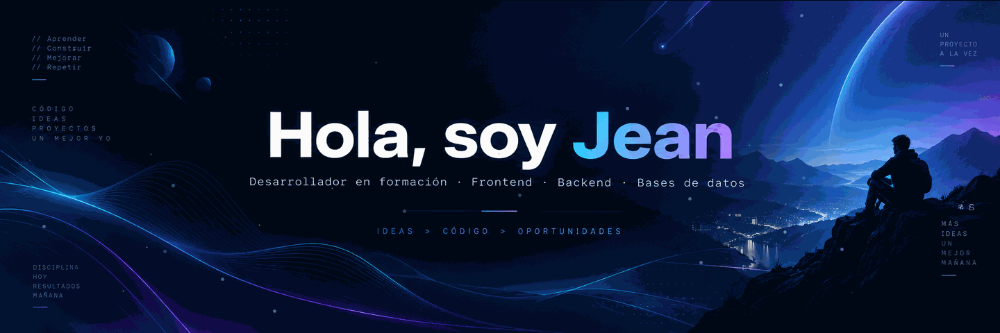

# Jean | Web Developer

[Español](#espanol) · [English](#english) · [Repositorios / Repositories](https://github.com/Jp3528?tab=repositories)

## Español

Desarrollo aplicaciones web que conectan interfaces, APIs y bases de datos. Mi portafolio reúne proyectos personales y académicos de comercio electrónico, gestión comercial y experiencias interactivas, con atención a la organización del código y a la documentación de su alcance.

Busco oportunidades de desarrollo web donde pueda aportar con proyectos concretos, trabajar en equipo y seguir fortaleciendo mis habilidades técnicas.

### Proyectos destacados

| Proyecto                                                       | Qué puedes explorar                                                                                              | Tecnologías                                |
| -------------------------------------------------------------- | ---------------------------------------------------------------------------------------------------------------- | ------------------------------------------ |
| [NexusCRM](https://github.com/Jp3528/CRM)                      | Gestión de clientes y ventas, permisos por equipo, documentos comerciales y auditoría.                           | Laravel, PHP, PostgreSQL, Blade, Alpine.js |
| [HomeSphere](https://github.com/Jp3528/HomeSphere)             | Tienda de hogar con ambientes interactivos, reservas de inventario y pagos simulados.                            | ASP.NET Core, C#, Next.js, PostgreSQL      |
| [Documint](https://github.com/Jp3528/Documint)                 | Biblioteca documental con permisos, versiones y pipeline en desarrollo; recuperación y RAG en fases posteriores. | Python, FastAPI, React, Celery, PostgreSQL |
| [CasaViva](https://github.com/Jp3528/CasaViva)                 | Catálogo, carrito, cuenta de cliente y flujo de compra con datos demo o PostgreSQL.                              | React, TypeScript, Express, PostgreSQL     |
| [NexaTech](https://github.com/Jp3528/Nexatech)                 | Tienda de tecnología con catálogo, API, pruebas y asistente de respuestas locales.                               | React, TypeScript, Express, Vite           |
| [Chatbot Clientes](https://github.com/Jp3528/Chatbot-CLiente-) | Prototipo de atención multi-negocio con motor local, API y widget embebible.                                     | Node.js, Express, JavaScript               |

### Frontend y experiencias interactivas

- [BEYOND MOTION](https://github.com/Jp3528/Animacion-cinematica-web-para-landing): narrativa visual por scroll y renderizado con Canvas 2D.
- [SABOR & MAÑANA](https://github.com/Jp3528/Sabor-y-Ma-ana): catálogo gastronómico y flujo de pedido hacia WhatsApp.
- [Distrito Alto](https://github.com/Jp3528/Landing-page-Premium-Home): landing inmobiliaria con catálogo filtrable.
- [Convoca Perú](https://github.com/Jp3528/Convoca-PERU): portal de oportunidades con Next.js y datos locales tipados.

### Tecnologías presentes en mis proyectos

- **Frontend:** JavaScript, TypeScript, React, Next.js, HTML y CSS.
- **Backend:** PHP/Laravel, Node.js/Express, C#/ASP.NET Core y Python/FastAPI.
- **Datos y herramientas:** PostgreSQL, MySQL/MariaDB, Git, Docker y GitHub Actions.
- **Prácticas que desarrollo:** separación de responsabilidades, APIs REST, autorización, pruebas y documentación técnica.

Cada README explica cómo ejecutar el proyecto y distingue las funciones implementadas, los datos de demostración y las etapas pendientes.

**Perfil y contacto profesional:** [GitHub · @Jp3528](https://github.com/Jp3528).

---

## English

I develop web applications that connect interfaces, APIs and databases. My portfolio includes personal and academic projects in e-commerce, sales management and interactive experiences, with attention to code organization and clear documentation of each project's scope.

I am interested in web development opportunities where I can contribute through practical projects, collaborate with a team and continue developing my technical skills.

### Featured projects

| Project                                                        | What to explore                                                                                                                      | Technology                                 |
| -------------------------------------------------------------- | ------------------------------------------------------------------------------------------------------------------------------------ | ------------------------------------------ |
| [NexusCRM](https://github.com/Jp3528/CRM)                      | Customer and sales management, team-based permissions, sales documents and auditing.                                                 | Laravel, PHP, PostgreSQL, Blade, Alpine.js |
| [HomeSphere](https://github.com/Jp3528/HomeSphere)             | Home goods store with interactive room scenes, inventory reservations and simulated payments.                                        | ASP.NET Core, C#, Next.js, PostgreSQL      |
| [Documint](https://github.com/Jp3528/Documint)                 | Permission-controlled document library, versioning and a pipeline under development; retrieval and RAG are planned for later phases. | Python, FastAPI, React, Celery, PostgreSQL |
| [CasaViva](https://github.com/Jp3528/CasaViva)                 | Catalog, cart, customer account and shopping flow using demo data or PostgreSQL.                                                     | React, TypeScript, Express, PostgreSQL     |
| [NexaTech](https://github.com/Jp3528/Nexatech)                 | Technology store with a catalog, API, tests and a local-response assistant.                                                          | React, TypeScript, Express, Vite           |
| [Chatbot Clientes](https://github.com/Jp3528/Chatbot-CLiente-) | Multi-business support prototype with a local engine, API and embeddable widget.                                                     | Node.js, Express, JavaScript               |

### Frontend and interactive experiences

- [BEYOND MOTION](https://github.com/Jp3528/Animacion-cinematica-web-para-landing): scroll-driven visual storytelling and Canvas 2D rendering.
- [SABOR & MAÑANA](https://github.com/Jp3528/Sabor-y-Ma-ana): food catalog and a WhatsApp order handoff.
- [Distrito Alto](https://github.com/Jp3528/Landing-page-Premium-Home): real estate landing page with a filterable catalog.
- [Convoca Perú](https://github.com/Jp3528/Convoca-PERU): opportunity portal using Next.js and typed local data.

### Technologies used in my projects

- **Frontend:** JavaScript, TypeScript, React, Next.js, HTML and CSS.
- **Backend:** PHP/Laravel, Node.js/Express, C#/ASP.NET Core and Python/FastAPI.
- **Data and tooling:** PostgreSQL, MySQL/MariaDB, Git, Docker and GitHub Actions.
- **Practices I am developing:** separation of concerns, REST APIs, authorization, testing and technical documentation.

Each README explains how to run the project and distinguishes implemented features, demonstration data and pending work.

**Profile and professional contact:** [GitHub · @Jp3528](https://github.com/Jp3528).
